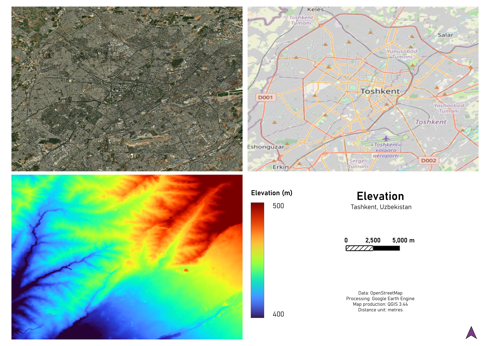
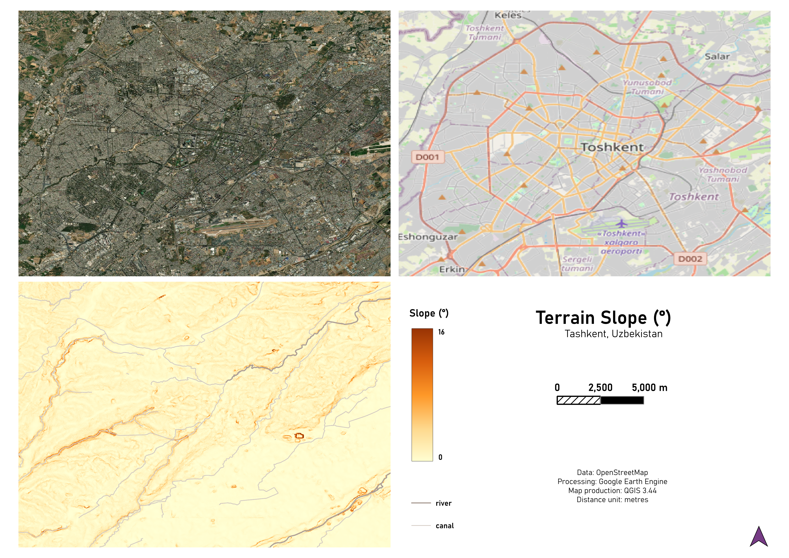
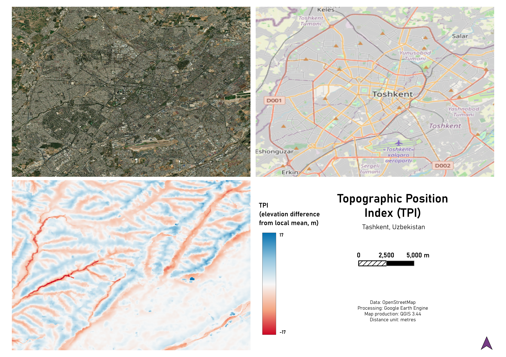

# Predictor Maps

This directory contains maps of the geospatial predictor variables used in the **Tashkent Urban Flood Susceptibility Mapping** project.

The predictor layers represent topographic, hydrological, and land-cover characteristics that may influence urban flood susceptibility. The datasets were prepared using **Google Earth Engine (GEE)** and the final maps were produced in **QGIS**.

## Elevation

Elevation represents the spatial variation in ground height across the Tashkent study area.

## Slope

Slope represents terrain steepness in degrees. Steeper and flatter areas can influence the direction, velocity, and accumulation of surface runoff.

## Topographic Position Index (TPI)

Topographic Position Index describes the relative elevation of each location compared with its surrounding terrain. It helps distinguish locally elevated areas from depressions and low-lying terrain.

## Land Cover

Land cover represents the spatial distribution of surface-cover classes across the study area. Differences between built-up, vegetated, bare, and other land-cover types can affect infiltration and runoff generation.

## Distance to Nearest River

This predictor represents the distance from each location to the mapped river network. Areas closer to rivers may experience different flood exposure compared with locations farther from major drainage channels.

## Distance to Nearest Canal

This predictor represents the distance from each location to the mapped canal network. Tashkent contains an extensive canal system that can influence local drainage and flood susceptibility.

## Purpose

These maps provide visual documentation of the predictor variables used in the flood-susceptibility modelling workflow. Together, they illustrate the spatial characteristics of the study area and the environmental factors considered by the model.

> **Note:** The PNG files shown here are cartographic visualizations for documentation and interpretation. They are not substitutes for the original numerical raster datasets used for spatial analysis and machine-learning modelling.

**Study area:** Tashkent, Uzbekistan  
**Geospatial processing:** Google Earth Engine  
**Cartography:** QGIS
